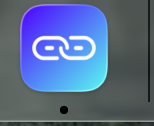
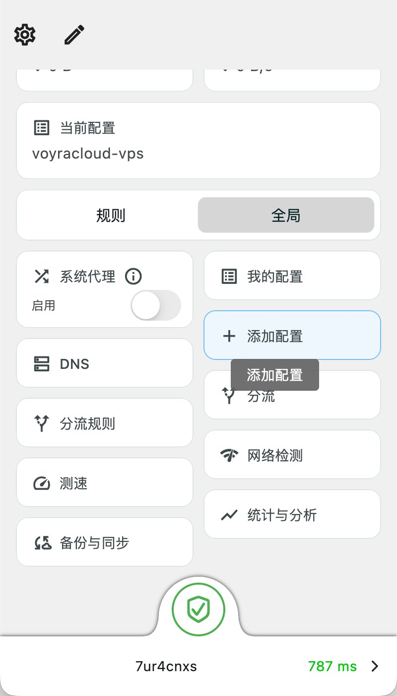

# Mac 手动接入与恢复

Mac＋iPhone 和 Mac＋Android 共用这一份电脑方案。Mac 使用 Karing，手机分别走 [Shadowrocket 指南](iphone.md) 或 [v2rayNG 指南](android.md)。这是待客户验收的手动分支。开始前先确认 Mac 的 Karing 与目标 Xray 版本能握手，后续按客户观察到的结果记录。

~~~text
保存旧连接和离线恢复卡 → 在 Mac 核对 Karing 安装来源 → 单独导入 Mac 节点
  → 先核对握手和出口 → 按约定启用 Karing VPN 和规则
  → 核对直连、应用路径、重启恢复 → 手机单独接入和验收
~~~

## 接入前

1. 用「关于本机」记录 macOS 版本与 Apple 芯片或 Intel。确认用户有应用安装权限。先保存本页、所选手机指南和 [恢复指南](recovery.md)。记录原 VPN、网络服务的代理状态、是否按需连接，以及原业务样本。企业管理设置由管理员处理。[Apple 的 Mac VPN 设置](https://support.apple.com/en-mo/guide/mac-help/mchlp1579/mac)
2. 既有节点先按 [VPS 指南](vps.md) 核对能否复用。需要新建时，先核对 Claude 使用条件、预算及 Karing 兼容风险，再由客户决定。确认 Mac 和手机各有独立身份，凭据、二维码和日志留在客户设备或 VPS。
3. 仅使用官方发行。已核对的 Karing v1.2.25.2802 macOS universal PKG 已与官方发行记录的文件字节数和 SHA-256 核对一致，安装器签名和实际安装待客户核对。对这一个固定版本的 PKG，可在 Mac 本地查看摘要与签名，核对通过后再打开安装程序。[官方发行页](https://github.com/KaringX/karing/releases/tag/v1.2.25.2802) · [Apple 关于 Gatekeeper 和开发者签名的说明](https://support.apple.com/en-us/102445)

~~~bash
shasum -a 256 "./karing_1.2.25.2802_macos_universal.pkg"
pkgutil --check-signature "./karing_1.2.25.2802_macos_universal.pkg"
~~~

该固定 PKG 的官方 SHA-256 为 `ce6a46d784ad096f299113e29661b018d68ac1dda4524f37b2234ebffcb38b35`。来源、摘要或系统签名检查有异常时停在此处。若采用 App Store 版，记录实际版本，按该版本重新核对导入与授权步骤。[官方资产元数据](https://api.github.com/repos/KaringX/karing/releases/tags/v1.2.25.2802) · [Karing 官方下载说明](https://karing.app/en/quickstart)

## 导入、连接和验收

1. 在客户指定窗口内，按 Karing 官方说明打开新增配置。用专属 Mac 节点的本地分享链接导入，或由节点所有者按 App 支持的方式录入。核对 VPS 地址、TCP 端口、Mac 的 UUID、Vision、REALITY 服务名、客户端公钥和 Short ID。将该节点保存为新条目。把链接视为凭据。使用剪贴板时避开云剪贴板并在完成后清除该条目。[Karing 官方导入说明](https://karing.app/en/app-manual/add-profiles)
2. 先核对实际握手和预期出口，再进入日常切换。Karing 项目曾有 v1.2.25.2802 在 Windows／Android 与 Xray 26.9.9 握手失败的报告。这个报告没有覆盖本项目的 macOS＋Xray v26.10.31 组合。若同样出现 REALITY 校验失败，记录两端版本、所用协议及脱敏报错，停在握手阶段，保留现有连接。版本更改按安全更新和影响单独决定。[Karing 上游兼容性记录](https://github.com/KaringX/karing/issues/1952) · [当前候选 Xray 发行](https://github.com/XTLS/Xray-core/releases/tag/v26.10.31)
3. 临时暂停原 VPN 的接管，选中 Karing 的 Mac 专属节点。应用发起 macOS VPN 授权时由客户本人核对并批准。按约定选择规则模式。VPN 接管方式和规则模式分别核对。只有约定目标确实支持系统代理并且验证过实际路径时，才按约定走系统代理方式。遇到额外权限请求或系统限制先确认必要性。[Karing 官方关于系统代理、TUN 和规则模式的说明](https://karing.app/en/faq)
4. 分别核对约定国内直连样本、VPS 出口和目标应用连接路径。使用实际应用触发一次新请求，把时间、命中规则和出站与本地证据对应。确认当前 Agent 能继续通信。重启或重新登录后，核对按需连接、活动规则及真实路径。客户本人在约定设备用官方 Claude App 或网页发送一条消息，收到新回复再记通过。[Karing 主页与规则模式](https://karing.app/en/app-manual/home)

## Mac 恢复

出现异常时，打开本地恢复卡。在 Karing 内断开本次连接。如果应用打不开，从 macOS 系统设置的 VPN 页面确认活动项后处理。若本轮打开了按需连接或系统代理，按原记录恢复对应选项。再打开原 VPN，选回原节点和模式，恢复后用原业务样本核对结果。遇到管理策略限制时，保存最后可确认的状态，使用预留的本地支持入口。[Apple 的 Mac VPN 设置](https://support.apple.com/en-mo/guide/mac-help/mchlp1579/mac) · [Karing 按需连接设置](https://karing.app/en/app-manual/settings)

Mac 分支使用 [本地脱敏反馈表](../docs/windows-iphone-field-test.md#4-客户反馈模板) 记录实际进度。手机独立导入，按对应指南验 Wi-Fi、蜂窝与重连。Agent 掉线后先恢复原业务，再从首个缺少证据的步骤续接。

## 固定 DMG 下载与导入图

客户已有 Python 3.9 或更高版本时，可在客户设备从本版目录下载固定 DMG：

~~~bash
python3 scripts/mac/download_karing.py --download
~~~

脚本只从官方地址下载 Karing 1.2.25.2802，校验 SHA-256；重复运行复用摘要匹配的文件。文件保存在 `runtime/mac-downloads/`，不自动挂载、安装、启动或修改代理。省略 `--download` 仅显示下一步，不联网。下载失败时保留原安装方式，不以未核验文件替代。

该 DMG 的 SHA-256 为 `90aba8e17bdf15564710e84e6328ce9c9d3edcf45c79eccc1d33995d50c2f458`。与上面的 PKG 是两种安装资源，摘要不能混用。安装和首次启动涉及系统授权时由用户完成。核对应用版本 `1.2.25`、构建号 `2802` 后继续导入。

点击“添加配置”，然后从剪贴板导入刚才复制的 VLESS 链接。下图仅用于识别按钮，图中的配置名、延迟与全局选中状态都不作为客户的验收结果或默认分流要求。

## 连接失败时

出现 `reality verification failed`、新节点反复失败，或后台测通但切换后 Agent 掉线时，直接转入 [Mac 故障处理](mac-troubleshooting.md)。先恢复可用连接，再依次核对 TUN 网络栈、节点字段、服务与时间；兼容组合按具体版本评估，跳过已尝试无效的步骤。导入成功和延迟数值不等于实际路径或 Claude 已通过。
