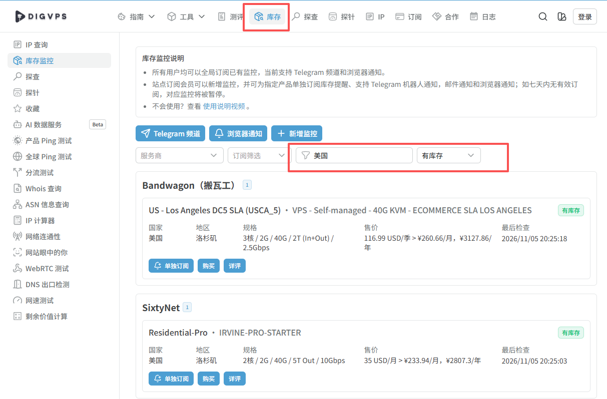
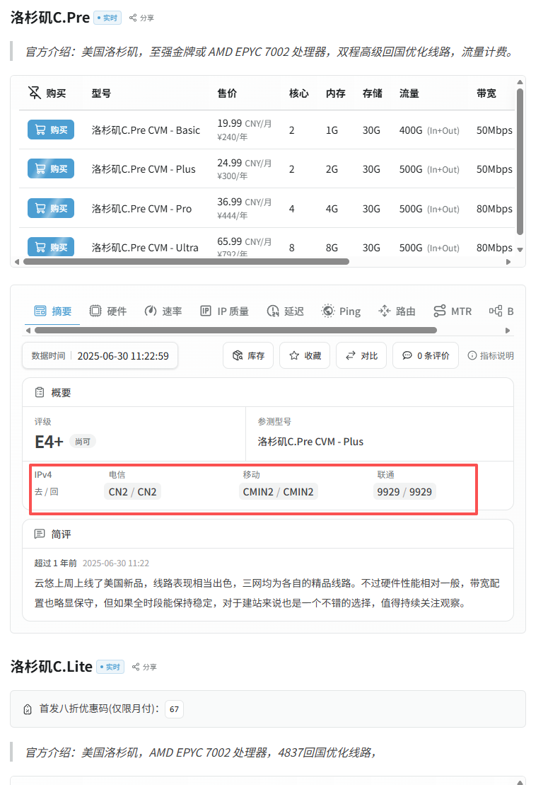
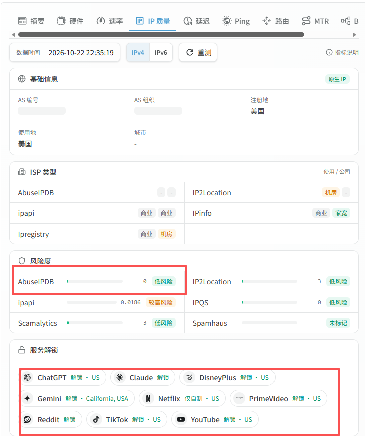

# VPS 节点选购与部署准备指南

**本项目 VPS 采购的主要参考守则。** 没有可复用节点、需要选购时，Agent 先按本页逐项引导客户。已有节点先走 [VPS 复用检查](vps.md)。

本页保留用户提供指南的正文与图示。价格、库存、评分及解锁状态是文中核对日期或截图时的记录，客户购买时重新核对。文末任务说明涉及的部署与分流方式，按 [本项目 VPS 指南](vps.md)、[Windows 指南](windows.md)或 [Mac 指南](mac.md)执行；本项目支持约定的 TUN 规则分流。密码、私钥在客户设备私下输入，不提交到公开仓库或聊天。

先筛选目标国家和套餐，再核查线路表现与 IP 质量。购买开通后，复核实际分配的 IP，并准备服务器登录资料，最后交给 Codex 按部署流程配置。

## 1 选择国家与套餐

打开 DigVPS，在“库存”页面按目标国家或地区筛选，并查看有库存的产品。需要时再按服务商、预算和计费周期缩小范围。[1]

如果主要用于日常访问 AI 服务和使用 Plus 或 Pro 订阅，可先比较满足线路、流量和 IP 质量要求的低价入门套餐，再按实际使用情况决定是否升级。

点击产品的“详评”查看测试结果。购买前同时核对月付或年付价格、流量配额、带宽和续费条件。

*图 1  在库存页面筛选目标国家和有库存的产品*

截图中的价格、库存与检测结果仅用于演示，购买时以最新页面为准。

## 2 查看节点速率与线路表现

进入“详评”后，重点查看“速率”“延迟”“Ping”“路由”与“MTR”等项目，结合自己的运营商判断线路是否合适。优先关注实际速度、丢包、抖动和晚高峰表现。

截图中的电信、移动、联通去回程线路可用于比较候选产品。套餐标注的带宽和线路名称需要结合实测数据判断，购买后还应在日常使用的网络上复测。

*图 2  查看套餐规格及各运营商的去回程线路*

## 3 核查 IP 质量与服务解锁

在“IP 质量”中查看风险度和服务解锁。按本流程筛选时，目标服务应显示绿色，并且解锁文字符合自己的使用要求。截图中 Netflix 标注为“仅自制”，应据此判断它能否满足需求。

AbuseIPDB 滥用评分要求为 0%。为满足无滥用记录的要求，还需查询同一 IP 的报告数，确认查询范围内为 0 条，并保存查询时间与范围。0% 评分本身不能证明没有历史报告。[2][3]

*图 3  核对 AbuseIPDB 风险评分及服务解锁文字*

评测数据用于购买前筛选。实际分配 IP 的质量与解锁结果，需要在开通后重新核验。

### 原生机房 IP 与静态住宅 IP

机房 IP 优先考虑标注为目标地区原生的地址，并核对目标服务的地区识别。对于商家标注的“广播 IP”，先复测地区与解锁情况，再决定是否采用。使用地区还应符合 Claude 官方支持范围。[4]

预算允许时，可比较独享静态住宅或 ISP IP，重点核对是否独享、是否固定、滥用记录和实际访问表现。这类产品通常比普通机房 IP 成本更高，具体以报价为准；住宅标签本身不能证明纯净度最高。[5]

## 4 开通服务器并交给 Codex 部署

通过产品的“购买”入口进入相应云服务商，确认地区、套餐及订单后完成购买。开通后的实际公网 IP、登录用户名及初始密码或密钥，在云厂商控制台或交付邮件中获取。按厂商提供的方式核对登录信息。[1]

先检查实际分配的 IP 是否与所购地区一致，再对该 IP 复核 AbuseIPDB 评分和报告数，并验证所需服务的解锁情况。满足要求后，再进入服务器部署。

### 准备交付资料

电脑系统与芯片架构，例如 Windows 或 macOS，以及 x64 或 ARM64。

服务器实际公网 IP、SSH 端口、登录用户名和认证方式。

服务器操作系统、版本及架构。

实际 IP 的核验来源、查询时间、报告范围、评分、报告数及解锁结果。

登录密码或密钥通过私密方式单独提供，公开文档中仅保留非敏感信息。

### 可交给 Codex 的任务说明

> 请先检查本机系统和工具是否齐全，并核对服务器登录方式及系统。先核验实际 IP 的 AbuseIPDB 评分为 0%，且查询范围内报告数为 0，再按交付程序部署 VLESS + REALITY + Vision。优先验证 TCP 443；如不可用，再验证备用端口。节点验证通过后，请让我明确选择系统代理规则分流或 TUN 全局模式，再生成并导入客户端配置，最后验收出口 IP、目标服务和退出重开后的连接。

## 参考链接

[[1] DigVPS 库存与购买入口](https://digvps.com/inventory)

[[2] AbuseIPDB 评分说明](https://www.abuseipdb.com/faq.html)

[[3] AbuseIPDB 查询范围与报告数说明](https://docs.abuseipdb.com/)

[[4] Claude 支持地区](https://support.claude.com/en/articles/8461763-where-can-i-access-claude)

[[5] ISP 与机房代理产品及报价示例](https://brightdata.com/pricing/proxy-network/isp-proxies)

页面核对日期  2026 年 11 月 5 日
